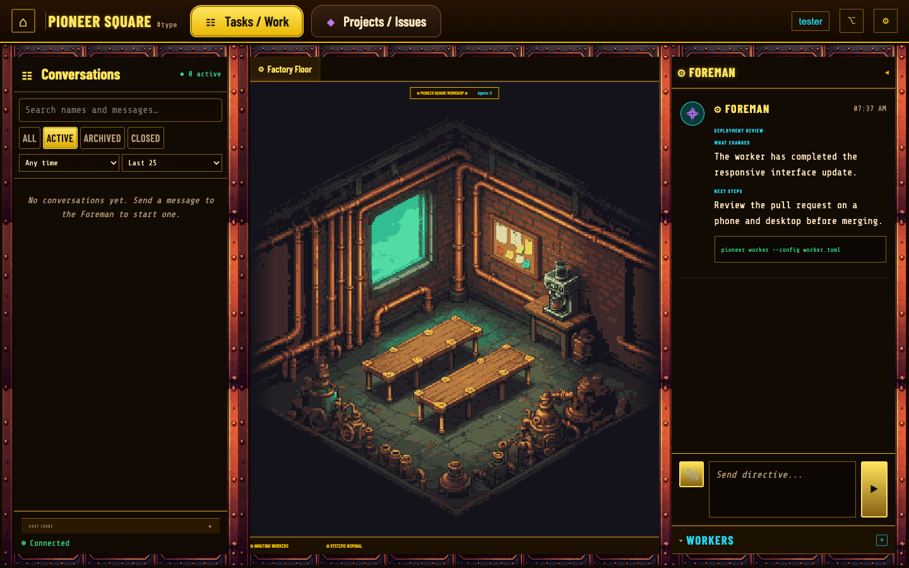
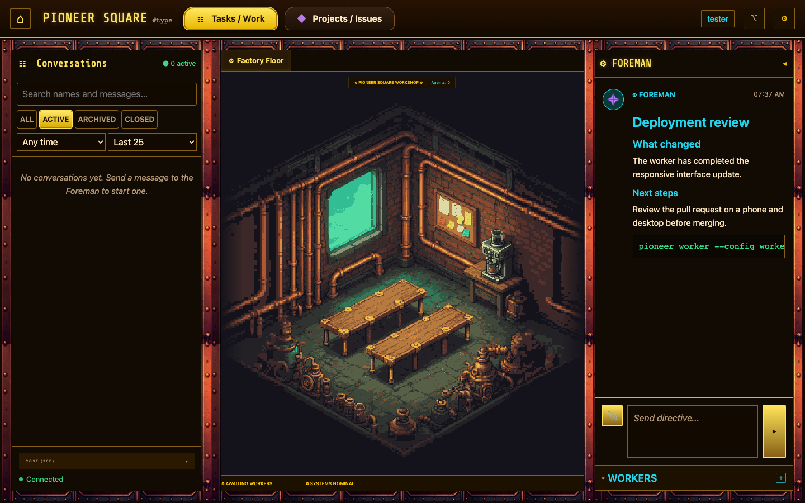
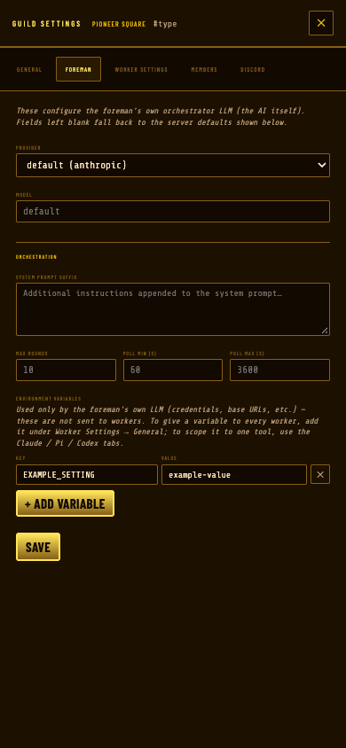
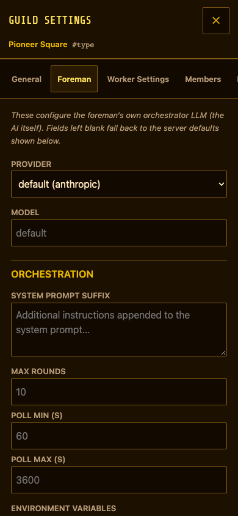
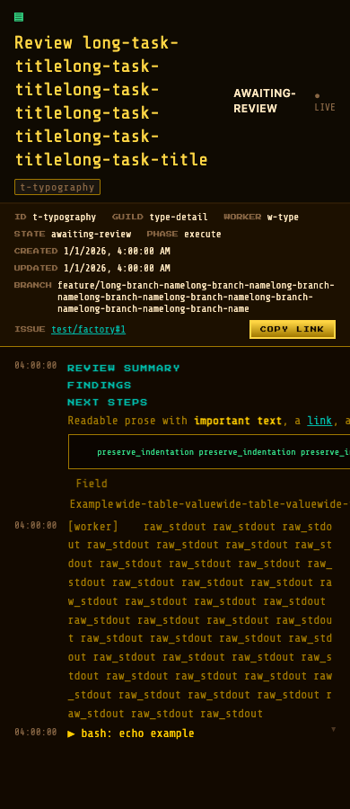
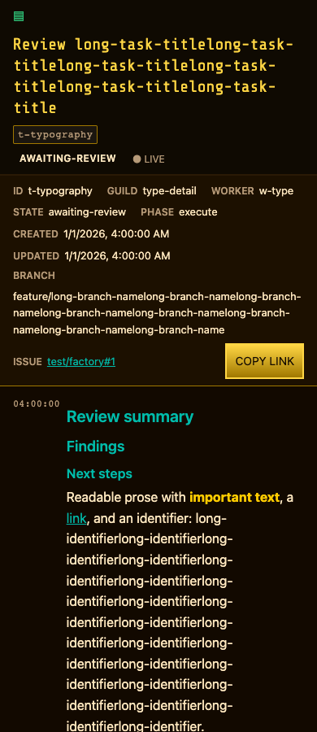
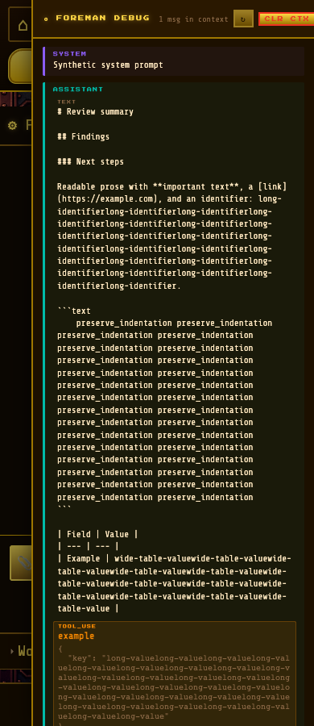
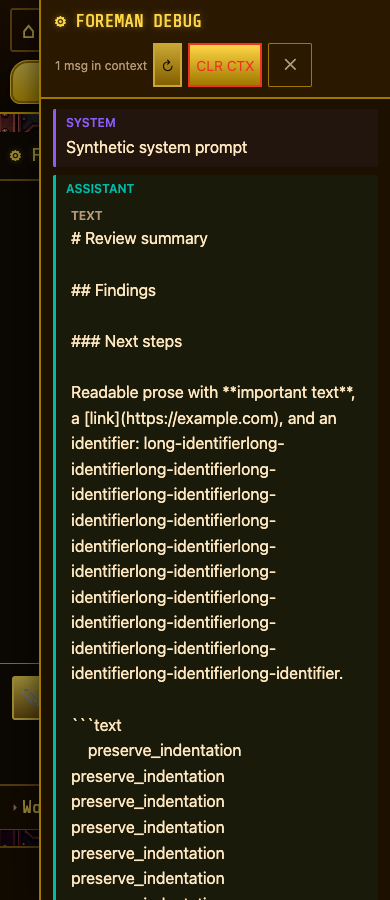

# Workspace typography

This is the working design rationale, not an accepted specification. The supplied
GPT-generated stylesheets were design inputs, not runtime dependencies.
**Do not import them into the app**: they would reintroduce global heading overrides,
a 13px root size, duplicate color tokens, and a second mobile cascade.

## Where styles belong

- `frontend/src/style.css`: shared font and size tokens; the existing button primitive.
  The opt-in `ui-surface` class gives the workspace, standalone task-log view, and
  teleported debug panel the same typography without relying on workspace ancestry.
- `frontend/src/markdown.css`: one `markdown-prose` class for rendered chat, task
  descriptions, assistant log prose, and issue bodies/comments. Code blocks and
  tables scroll internally. Components do not duplicate these descendant rules.
- `frontend/src/settings.css`: shared settings input, save-status, and environment-row
  primitives, replacing their component-local copies; dialog font defaults and focus rings.
- Component `<style scoped>` blocks: the component's typography, using those tokens.
- `frontend/src/workspace.css`: workspace theme and layout, including responsive layout.
  Do not add a second typography override for a component here.
- The pixel-art landing page retains its existing visual identity.

## Font choices

- **System sans-serif** for conversation titles, messages, issue prose, navigation,
  forms, and controls. It is easier to read at small sizes and fits more content
  than an all-monospace interface, without another font download.
- **Share Tech Mono**, already loaded, for guild identity and major pane headings.
  Use its real 400 weight, not simulated bold. Avoid it for paragraphs.
- **System monospace** in the workspace for code, terminal output, IDs, and branches.
  Use tabular numerals for timestamps and counts rather than making all prose monospace.
- No additional IBM Plex download; the separate Barlow Condensed import is removed.

## Scale

Sizes below assume the browser's default 16px root. Keep the root size under user
control; use rem tokens rather than resetting `html` to the body size.

| Role                           | Token                  | Desktop       | Phone (≤700px) |
| ------------------------------ | ---------------------- | ------------- | -------------- |
| Page/pane title                | `--text-page-title`    | Fluid 20–24px | Fluid 20–24px  |
| Section heading                | `--text-section-title` | 18px          | 18px           |
| Conversation/card title        | `--text-card-title`    | 16px semibold | 16px semibold  |
| Reading text                   | `--text-body`          | 15px          | 16px           |
| Secondary text/navigation tabs | `--text-small`         | 13px          | 13px           |
| Metadata/status                | `--text-caption`       | 12px          | 12px           |
| Text inputs                    | `--text-input`         | 16px          | 16px           |

Reading text uses 1.6 line-height; headings use 1.3. Titles can wrap. Code blocks
scroll within their pane instead of widening the layout. Markdown h1/h2/h3 have
distinct sizes instead of sharing one tiny uppercase style.

## Responsive rules

- Use the existing 700px phone-layout breakpoint, not another 640px type breakpoint.
- Do not shrink reading text or inputs to fit. A 16px input also avoids the usual
  iPhone focus zoom caused by smaller controls.
- Main mobile buttons have a 44px minimum height; metadata is not a touch target.
- Remove decorative message avatars on phones to recover horizontal reading space.
- Preserve the existing 1024px single-pane navigation and project list/detail flow.

## Scope and remaining checks

This pass covers the workspace header, navigation labels, conversation list/detail,
Foreman messages, issue content, worker labels, guild settings, user preferences,
and the spawn dialog. It removes corresponding workspace typography overrides and
repeated settings primitives rather than importing either generated stylesheet.
Environment inputs stack on phones; long names, hints, and errors can wrap. The spawn
dialog retains its visual-viewport keyboard handling and safe-area footer.

The follow-up pass covers task-tree names/badges, task and worker actions, log
headers/details, usage/cost summaries, issue metadata, the standalone task-log view,
and the teleported debug panel. Nested task indentation is capped at 20% of the row
width; action forms wrap and scroll instead of taking over the log pane. Raw output
and tool payloads remain monospace, with whitespace preserved. Assistant prose uses
the normal reading color rather than the dim terminal-metadata color.

Real-device Safari, user font preferences, and a full contrast audit still need
human verification. Browser smoke tests cover 320–1440px, all guild-settings/spawn
tabs, personal worker preferences, deeply nested task rows, action forms, standalone
logs, issue comments, and teleported debug text. They also check raw-output and code
indentation preservation. Decorative landing typography and other legacy dialogs
are outside these passes.

## Screenshots

Screenshots use synthetic local fixtures, not production data.

| Surface                     | Before                                                          | After                                                         |
| --------------------------- | --------------------------------------------------------------- | ------------------------------------------------------------- |
| Workspace (1440px)          |        |        |
| Foreman settings (390px)    |  |  |
| Standalone task log (390px) |  |  |
| Debug panel (390px)         |     |     |
